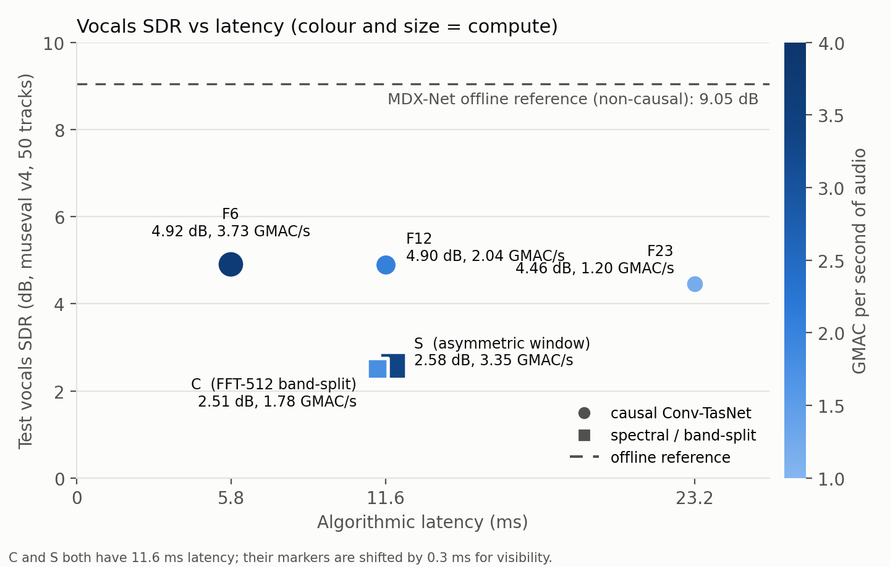

# Real-time vocal separation with 11.6 ms algorithmic latency

Causal Conv-TasNet models that separate vocals from a stereo music mix while streaming in 512-sample blocks on one
CPU thread, for live-performance use cases (in-ear monitoring, live remixing, karaoke on stage) where a few
milliseconds of delay are audible.

**Audio demo:** https://yunqiyunqili.github.io/realtime-vocal-separation/ (source in [`docs/`](docs/))

## Main results

MUSDB18-HQ test set (50 tracks), streaming inference with ONNX Runtime, block 512. CPU timing is single-thread on an
otherwise idle (exclusively allocated) Intel Xeon Gold 6150 node; the per-block budget is 512 / 44100 s = 11.61 ms.

| Model | Window / hop (samples) | Algorithmic latency | **Test vocals SDR** | uSDR mean | GMAC/s | Params | p99 per block | RTF |
|---|---|---|---|---|---|---|---|---|
| F23 | 1024 / 256 | 23.2 ms | 4.46 dB | 4.84 dB | 1.20 | 7.07 M | 5.53 ms | 0.43 |
| **F12** | 512 / 128 | **11.6 ms** | **4.90 dB** | **5.07 dB** | 2.04 | 6.02 M | 5.62 ms | 0.44 |
| F6 | 256 / 64 | 5.8 ms | 4.92 dB | 5.16 dB | 3.73 | 5.49 M | 7.22 ms | 0.56 |
| MDX-Net vocals (offline reference) | non-causal | - | 9.05 dB | 8.96 dB | - | 7.42 M | - | - |

- Algorithmic latency = (window - 1) / 44100 s, the worst-case lookahead verified by a causality probe. The output
  of F12 lags its input by a fixed 384 samples (8.7 ms).
- p99 and RTF are the medians of 3 repetitions of 60 s of audio each (RTF = median block time / 11.61 ms). No run
  of F12 or F6 exceeded the budget; F23 exceeded it once in about 15,000 calls.
- MDX-Net = the vocals TFC-TDF component of the MDX'21 Track A winner (not the full blend), with its official
  offline, whole-segment inference; it is an upper reference, not a real-time candidate.
- The 49-track numbers (without "PR - Oh No") and median uSDR are in [`results/summary.csv`](results/summary.csv).



### Architecture comparison at 11.6 ms

Two music-specific spectral / band-split models (MusicSparse, inspired by the band compression of SCNet) at the same
algorithmic latency, same test protocol, same timing node:

| Model | Test vocals SDR | uSDR mean / median | Valid SDR | Params | GMAC/s | p99 per block |
|---|---|---|---|---|---|---|
| **F12** (causal Conv-TasNet) | **4.90 dB** | **5.07 / 5.11 dB** | 4.75 dB | 6.02 M | 2.04 | 5.62 ms |
| S (MusicSparse, asymmetric 1024/512 window, hop 128) | 2.58 dB | 2.97 / 3.38 dB | 3.60 dB | 0.63 M | 3.35 | 5.95 ms |
| C (MusicSparse, FFT 512, hop 128) | 2.51 dB | 2.67 / 3.15 dB | 2.75 dB | 0.63 M | 1.78 | 2.67 ms |

The MusicSparse models are not capacity-matched to F12 (about 10x fewer parameters) and were trained on a smaller
budget (30-epoch cap). GMAC/s for C and S counts dense operations only.

### Robustness to mixing effects

The 50 test tracks were re-mixed with a random effects chain (per stem: peaking EQ, compressor, reverb on vocals and
"other"; then a stereo-linked limiter on the mix; one fixed seed per track, see `rtvs/effects.py`), and evaluated
against the processed vocals. uSDR is the primary metric here because reverb tails produce extreme museval frame
values.

| Model | Clean test uSDR mean / median | Effects test uSDR mean / median |
|---|---|---|
| F12 | 5.07 / 5.11 dB | 4.85 / 5.16 dB |
| F12 fine-tuned with effects augmentation | 5.08 / 5.18 dB | 4.81 / 4.86 dB |

F12 loses about 0.22 dB of mean uSDR under the effects chain (the median even rises slightly). Fine-tuning with the
same kind of effects as augmentation gave no measurable gain (paired median difference +0.03 dB, better on 28/50
tracks).

### Real-device deployment

Apple M2 Pro laptop, Core Audio, block 512, ONNX Runtime 1 thread, using [`deploy/realtime_test.py`](deploy/):

| Test | Result |
|---|---|
| File playback (wav -> F12 -> headphones) | inference p50 3.50 ms, p99 4.00 ms, max 6.11 ms; RTF 0.30; 6,907 callbacks, 0 blocks over budget, **0 xruns** |
| Acoustic loopback (built-in speaker -> built-in microphone) | round trip 135.8 ms passthrough, 144.5 ms through the model: **the model adds 8.7 ms**, matching its 384-sample output delay; 8/8 clicks reliable on both paths |

The 135.8 ms passthrough round trip comes mostly from the MacBook's built-in speaker / microphone device buffering,
not from the model. The playback run was stopped manually after 80.6 s. Raw JSON: [`results/device/`](results/device/).

## Findings

1. **For Conv-TasNet, lowering latency did not lower SDR; compute is the real constraint.** Going from a 23.2 ms to
   an 11.6 ms and a 5.8 ms window kept test SDR at 4.46 / 4.90 / 4.92 dB, while compute grew from 1.20 to 2.04 and
   3.73 GMAC/s because a shorter hop means more frames per second. F6 still fits the CPU budget (p99 7.2 ms of
   11.6 ms) but has the least headroom.
2. **At 11.6 ms, the waveform model is about 2.3 dB better than the best music-specific spectral / band-split model**
   (F12 4.90 dB vs S 2.58 dB and C 2.51 dB), subject to the capacity and training-budget caveat above.
3. **The asymmetric analysis window looked promising on valid but did not hold on test.** S beat C by +0.85 dB on
   valid (3.60 vs 2.75) but only +0.07 dB on test (paired median +0.14 dB SDR / +0.20 dB uSDR, better on 30/50
   tracks). With one seed per model this is not an established effect; it would need several seeds.
4. **F12 is already fairly robust to common mixing effects** (EQ, compression, reverb, limiting): -0.22 dB mean uSDR,
   and effects-augmented fine-tuning did not improve on it.

**Limitations.** One training seed per model. Separated vocals still contain audible artifacts, including a buzz at
multiples of 344.5 Hz (the frame rate of the 128-sample hop). Real-device tests so far cover one macOS laptop;
Windows and Linux audio stacks are untested.

## Evaluation protocol

- **Data:** MUSDB18-HQ, 44.1 kHz stereo. Train = the 86 official training tracks, valid = the official 14-track
  validation subset, test = the 50 test tracks ([`splits/`](splits/)).
- **Metric:** museval BSS Eval v4, joint evaluation of [vocals, accompaniment = mixture - vocals estimate], 1-s
  windows; per-track median over windows, then the median over tracks. Also whole-track uSDR (mean and median
  over tracks). Silent-window NaNs are diagnosed and counted; no model produced all-zero output over sung windows.
- **Inference:** whole tracks, ONNX Runtime, block-512 stateful streaming with the fixed model delay removed; no
  normalization, lookahead or chunk averaging. Streaming output equals the offline output within 1e-4.
- **Selection:** model selection and early stopping use valid only; every reported model was evaluated on test
  exactly once.
- **Timing:** ONNX Runtime CPU, 1 intra-op / 1 inter-op thread, sequential, block 512, process pinned to one core,
  3 interleaved repetitions of 60 s audio, first 20 calls discarded. Software timing, not device latency.

## Repository layout

```
rtvs/            model (causal Conv-TasNet), streaming core (StreamCore), data, metrics, effects, ONNX helpers
scripts/         train, evaluate, check_model (causality / streaming), export_onnx, benchmark, make_figure
experimental/    comparison models: MusicSparse (C, S), RT-STT adaptation, and their training scripts
deploy/          real-time sound-card test for laptops (numpy, soundfile, sounddevice, onnxruntime only)
docs/            audio demo page (GitHub Pages)
results/         summary.csv (all README numbers with sources), figure, device results
tests/           causality and streaming-consistency tests on random-init models (CPU, < 1 min)
splits/          train / valid / test track lists
```

The code in `experimental/` is kept for the comparison experiments above; it is not needed to train, evaluate or
deploy F12. See [`experimental/README.md`](experimental/README.md).

## Usage

```bash
pip install -r requirements.txt          # museval needs ffmpeg on PATH
pytest                                   # ~1 minute on CPU
export MUSDB18HQ_ROOT=/path/to/musdb18hq # or pass --musdb-root to each script
```

**Train** (one CUDA GPU; resumable by re-running the same command):

```bash
python scripts/train.py --config F12 --out runs/F12       # F23 / F12 / F6
```

**Evaluate** (valid by default; test requires an explicit flag):

```bash
python scripts/evaluate.py --ckpt runs/F12/best.pt --out eval/F12_valid
python scripts/evaluate.py --ckpt runs/F12/best.pt --out eval/F12_test --split test --confirm-test
python scripts/evaluate.py --ckpt runs/F12/best.pt --out eval/F12_test_fx --split test --condition effects --confirm-test
```

**Check causality and streaming consistency** of a checkpoint:

```bash
python scripts/check_model.py --ckpt runs/F12/best.pt --wav song.wav
```

**Export to ONNX** (block-512 streaming graph with explicit state, verified against offline PyTorch):

```bash
python scripts/export_onnx.py --ckpt f12_model.pt --out-dir deploy/
```

**CPU timing:**

```bash
python scripts/benchmark.py --out timing/ F23=f23.pt F12=f12_model.pt F6=f6.pt
```

**Real-time test on a laptop** (see [`deploy/README.md`](deploy/README.md)):

```bash
cd deploy && pip install -r requirements.txt
python realtime_test.py --wav song.wav                 # mode A: file -> model -> speakers
python realtime_test.py --mode latency                 # mode B: click loopback latency
```

## Pretrained weights

The F12 checkpoint (`f12_model.pt`, 24 MB, epoch 75, SHA256 `c72b34b3b93b...`) and its exported streaming model
(`f12_stream_block512.onnx` + `model_meta.json`) are published as GitHub Release assets rather than committed to
git. Put the ONNX files into `deploy/` for the real-time test.

## Acknowledgements

- **Conv-TasNet:** Y. Luo and N. Mesgarani, "Conv-TasNet: Surpassing Ideal Time-Frequency Magnitude Masking for
  Speech Separation", IEEE/ACM TASLP, 2019. The model here is an independent causal, streaming implementation.
- **DTTNet:** J. Chen et al., "Music Source Separation Based on a Lightweight Deep Learning Framework (DTTNet:
  Dual-Path TFC-TDF UNet)", ICASSP 2024. The TFC-TDF building blocks in `experimental/rtstt.py` are adapted from
  [DTTNet-Pytorch](https://github.com/junyuchen-cjy/DTTNet-Pytorch) (Apache-2.0; see [`NOTICE`](NOTICE)).
- **SCNet:** W. Tong et al., "SCNet: Sparse Compression Network for Music Source Separation", ICASSP 2024; it
  inspired the band compression in the MusicSparse comparison models (no code reused).
- **museval:** F.-R. Stöter, A. Liutkus and N. Ito, "The 2018 Signal Separation Evaluation Campaign", LVA/ICA 2018.
- **MUSDB18-HQ:** Z. Rafii, A. Liutkus, F.-R. Stöter, S. I. Mimilakis and R. Bittner, "MUSDB18-HQ - an
  uncompressed version of MUSDB18", 2019. The demo clips are short excerpts for non-commercial research
  demonstration; all rights remain with the original artists.

## License

Apache License 2.0 ([`LICENSE`](LICENSE)), because `experimental/rtstt.py` adapts Apache-2.0 code from
DTTNet-Pytorch; see [`NOTICE`](NOTICE) and [`third_party/DTTNet/LICENSE`](third_party/DTTNet/LICENSE).
